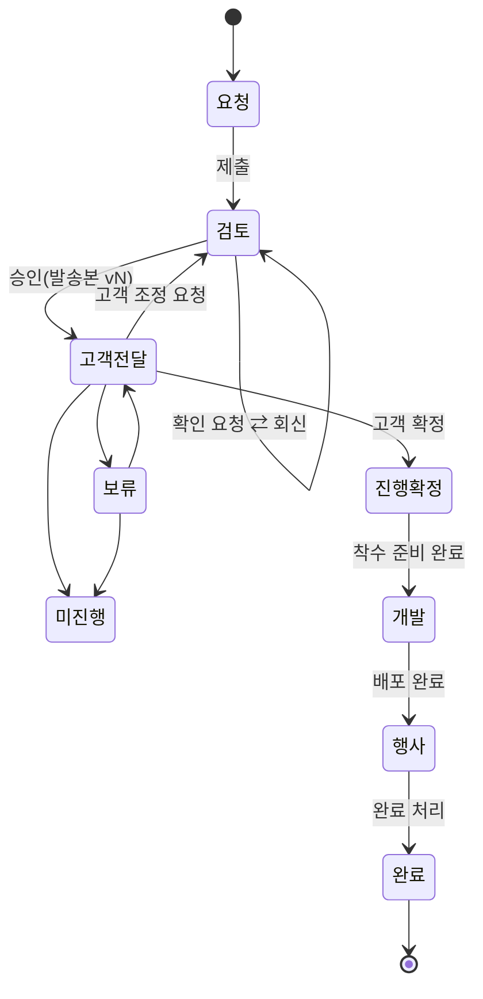

# 04. 설계 — 정보 구조 · 상태 모델 · 화면 · 데이터

> 이 문서는 UX·도메인 설계까지다. 컴포넌트 단위 구현 계획은 승인 후 별도(`/sc:workflow`)로 만든다.

## 1. 정보 구조(IA)

```
/                       → 역할별 홈으로 리다이렉트
/request                사업팀 새 요청 (시작 방법 → 행사 → 체험 → 장비 → 자료 → 점검)
/home                   "내 차례" 함 (역할별 내용 다름)
/quotes                 전체 견적 목록 (단계 필터 · 검색 · 외주 탭(dev))
/quotes/[id]            견적 작업 공간
    ├─ 개요            단계 스텝퍼 · 다음 행동 · 핵심 정보
    ├─ 견적            항목(dev 편집) · 버전 비교 · Excel
    ├─ 확인 요청        금액 영향 / 진행 확정 때
    ├─ 진행            확정 정보 · 자료 체크리스트 · 착수 준비 · 배포
    ├─ 대화            자유 댓글
    └─ 활동            상태·금액·버전 이력
/dev-board              개발 카드 보드 (dev_staff 기본 홈, 금액 없음)
/cleanup                정리함 (dev) — 행사일 지남 · 완료 대기 · 입금 대기
/calendar               달력 (유지)
/reports                매출 리포트 (dev, 목록과 집계 공유)
/settings
    ├─ packages         표준 패키지 편집 (dev)
    ├─ modules          모듈 단가 (dev, 유지)
    └─ profile
```

역할별 첫 화면: sales → `/home`(회신 필요·확정 입력 대기 우선) / dev → `/home`(검토 대기·회신 도착·착수 준비) / dev_staff → `/dev-board`.

## 2. 상태 모델

DB 상태값(9개)은 유지하되, 화면에서는 **7단계 + 이탈 2종** 과 **다음 행동 주체(ball-in-court)** 로 보여준다.

| 사용자 단계 | DB status | 하위 상황(파생) | 다음 행동 주체 |
|-------------|-----------|-----------------|----------------|
| 1 요청 | draft | 작성 중 | 사업팀 |
| 2 검토 | pending, reviewing | 검토 대기 / 회신 대기(열린 금액 영향 질문) / 보완 요청 | 개발팀 · 회신 대기면 사업팀 |
| 3 고객 전달 | approved | 전달 전 / 고객 회신 대기 N일 / 행사일 지남 | 사업팀 · 고객사 |
| 4 진행 확정 | confirmed (착수 준비 미완) | 자료 대기 / 착수 준비 | 사업팀(자료) · 개발팀(세팅) |
| 5 개발 | confirmed (착수 준비 완료, 미배포) | D-day / 초과 / 배포 미확인 | 개발 담당 |
| 6 행사 | confirmed (배포 완료) | 행사 전 / 행사 중 / 완료 처리 대기 | 개발팀 |
| 7 완료 | completed | 입금 대기 / 정산 완료 | 관리 |
| 이탈: 보류 | on_hold | 사유 | 사업팀 |
| 이탈: 미진행 | lost, rejected | 사유 | — |

- 4·5·6단계는 status를 늘리지 않고 `confirmed` + 체크리스트·배포 여부로 파생한다(기존 `lifecycle.ts` 확장).
- `rejected`는 열린 질문 결정 전까지 유지하되 화면에서는 "미진행"과 같은 이탈 묶음으로 표시.
- 다음 행동 주체는 서버에서 계산해 목록·홈·알림이 같은 값을 쓴다.



## 3. 체험 단계 → 견적 항목 매핑

사업팀 입력의 단위를 **체험 단계(Experience Step)** 로 바꾸고, 모듈은 매핑 결과로만 노출한다.

| 체험 단계(사업팀이 보는 이름) | 매핑 모듈 | 동반 자동 포함 | 자료 체크리스트 생성 |
|-------------------------------|-----------|----------------|----------------------|
| 시작 화면 | (UI_BASIC에 포함) | UI_BASIC | 시작 화면 디자인 |
| 사진 촬영 | CAM_PHOTO | UI_BASIC | 촬영 프레임/가이드 디자인 |
| 휴대폰 사진 올리기(QR) | QR_UPLOAD | UI_BASIC | — |
| 배경·디자인 고르기 | SELECT_PRINT | UI_BASIC, PRINT_SDK | 배경 시안 N종 |
| 이름·문구 입력 | TEXT_INPUT | UI_BASIC | 입력 항목·글자 수, 폰트 |
| 결제 | KSNET_PAY | UI_BASIC | KSNET 가맹점 코드 |
| 카드 인쇄 | PRINT_SDK | UI_BASIC | 카드 앞/뒷면 시안 |
| NFC 기록 | NFC_ENCODE | PRINT_SDK | 기록 데이터 규격 |
| AI 화풍 변환 | AI_STYLE(협의), AI_FEE | UI_BASIC | 스타일 레퍼런스 |
| 모바일로 받기 | (신규 모듈 후보, 현재 커스텀 +150K) | UI_BASIC | — |
| 기타(직접 설명) | 없음 → 개발팀이 커스텀 항목 작성 | — | — |

- TEST_QA는 모든 견적 자동 포함(현행 유지).
- 매핑표는 코드 상수가 아니라 **표준 패키지·모듈 관리 화면에서 편집 가능한 데이터**로 둔다(신규 모듈 추가 시 개발 배포 불필요).
- 현재 `requestItems.ts`의 `PRINT_SDK_TRIGGERS`, 선택 인쇄·KSNET 이중 경로는 이 매핑으로 대체한다.

## 4. 화면 설계

### 4.1 요청 작성 `/request` (P1·P2)
- 좌측: 단계 진행(시작 방법 → 행사 → 체험 → 장비 → 자료 → 점검). 우측 고정: **"이렇게 견적됩니다"** 패널(항목·예상 금액·자동 포함 이유).
- 체험 단계 화면: 카드 팔레트에서 클릭하면 아래 흐름 레일에 추가, 드래그로 순서 변경. 각 카드에 옵션 1~2개만(예: 배경 개수, 입력 항목 수).
- 장비 화면: 세그먼트 선택 + "아직 모름". Smart31/51 선택 시 인쇄 사이즈 영역 사라짐.
- 점검 화면: ✔ 완료 / ⚠ 모름 → 확인 요청으로 넘어감 / ✖ 필수 누락. 제출 버튼은 ✖가 없을 때만 활성.

### 4.2 홈 `/home`
- 상단 한 줄 요약: "회신 필요 2 · 확정 입력 대기 1 · 자료 미전달 1"(sales) / "검토 대기 3 · 회신 도착 2 · 착수 준비 1"(dev).
- 카드 목록: 견적번호 · 행사명 · 행사일 · 단계 · **다음 행동 버튼**(예: "질문 2개 답하기", "고객 확정 입력").
- "기다리는 중" 접힘 영역: 다른 주체 차례인 내 견적.

### 4.3 견적 작업 공간 `/quotes/[id]`
- 헤더: 견적번호·행사명·유형 배지·**단계 스텝퍼(7단계)**·다음 행동 주체 칩.
- **주요 행동 버튼은 헤더 우측 1개 + 더보기 메뉴**. 현재 하단 액션바의 버튼 7~8개를 단계별 1차 행동 1개로 축소.
  - 검토: dev "승인하고 전달" / sales "질문에 답하기"
  - 고객 전달: sales "고객 확정 입력" · 더보기(조정 요청, 보류, 미진행)
  - 진행 확정: dev "착수 준비 완료" / sales "자료 올리기"
  - 개발: dev·dev_staff "배포 완료"
  - 행사: dev "완료 처리"
- 되돌리기 계열(승인 철회, 확정 취소, 개발 완료 취소)은 더보기 안에 두고, 지워지는 값을 확인 화면에 나열.
- 탭: 개요 · 견적 · 확인 요청 · 진행 · 대화 · 활동. dev_staff에게는 견적 탭과 금액 필드가 없음.

### 4.4 개발 보드 `/dev-board` (P4)
- 칸반: 착수 준비 · 자료 대기 · 개발 중 · 배포 완료(행사 전) · 행사 중.
- 카드: 행사명, 납기 D-day, 행사일, 프린터·기기, 자료 진행(3/5), 담당자.

### 4.5 정리함 `/cleanup` (P5)
- 탭 3개(행사일 지남 / 완료 처리 대기 / 입금 대기), 각 행에 체크박스.
- 일괄 행동: 미진행 처리(사유 선택) · 완료 처리 · 계약금/잔금 입금일 기록.

## 5. 데이터 모델 변경(개념)

| 대상 | 변경 | 목적 |
|------|------|------|
| `QuoteVersion` (신규) | quoteId, version(n), items 스냅샷(JSON), subtotal/vat/total, approvedBy, approvedAt, emailResult | C4·C5 발송본 |
| `QuoteQuestion` (신규) | quoteId, group(price/after_confirm), order, kind(choice/text), prompt, options(JSON: label, priceDelta?), answer, answeredBy/At, appliedAt, source(dev/auto_unknown), status(open/answered/applied/closed) | B1~B6 |
| `QuoteChecklistItem` (신규) | quoteId, kind(material/setup), label, status(received/expected/not_needed/done), dueDate, attachment, link | D2·D4 |
| `ActivityLog` (신규) | quoteId, actorId, action, payload, createdAt | NFR-4 (이력 댓글 분리) |
| `Package` (신규) | name, steps(JSON), defaultOptions, isActive | A1·A10 |
| `ExperienceStepDef` (신규 또는 Module 확장) | key, label(고객 언어), moduleCodes, autoIncludes, materials | 3장 매핑 |
| `Quote` | `experienceSteps`(JSON, 순서 포함) 추가, `screenComposition`은 마이그레이션 후 읽기 전용 | A2 |
| `Quote` | `deliveredAt`(고객 전달일), `ballInCourt`는 저장하지 않고 계산 | E1 |
| `Notification` (신규) | userId, quoteId, type, readAt | F1 |

마이그레이션: 기존 견적마다 v1 스냅샷 생성, `screenComposition`을 체험 단계로 변환(매핑 불가 값은 "기타"), 기존 댓글은 "대화"로 이동, 상태 이력 댓글은 활동 로그로 복사.

## 6. 권한 매트릭스

| 기능 | sales | dev | dev_staff |
|------|-------|-----|-----------|
| 요청 작성·자기 견적 수정(검토 전) | ✔ | ✔ | — |
| 금액 보기 | 자기 견적 | 전체 | **불가(API에서 제거)** |
| 항목 편집·승인·버전 | — | ✔ | — |
| 확인 요청 생성 | — | ✔ | ✔(비금액 그룹만) |
| 확인 요청 회신 | ✔ | ✔ | — |
| 고객 확정·자료 업로드 | ✔ | ✔ | 자료 업로드만 |
| 착수 준비 체크·배포 완료 | — | ✔ | 배포 완료 |
| 정리함·리포트·입금 | — | ✔ | — |

## 7. 단계별 진행 제안

| 단계 | 내용 | 근거 |
|------|------|------|
| R0 (즉시, 작음) | dev_staff 금액 API 차단 + 회귀 테스트, 검토 시작 자동화(C1) | 보안 구멍, 클릭 1회 제거 |
| R1 | 홈 "내 차례" + 다음 행동 주체 계산 + 상세 액션 버튼 축소(E1·E2·4.3) | 헷갈림의 직접 원인, 데이터 변경 최소 |
| R2 | 확인 요청 카드 + 인앱 알림(B·F) | 회신을 시스템 안으로 |
| R3 | 체험 단계 요청서 + 표준 패키지 + 매핑(A) | 수동 항목 41% 감소, 가장 큰 변경 |
| R4 | 발송본 버전(C4·C5) | 정확한 기록 |
| R5 | 확정 마법사·자료/착수 체크리스트·개발 보드(D) | 확정 후 처리 |
| R6 | 정리함 일괄 처리·리포트 집계 통합(E3·E4) | 관리 효율 |

R1·R2를 먼저 하는 이유: 사업팀이 꼽은 세 고충 중 "질문 회신"과 "확정 후 처리"는 화면 구조만 바꿔도 줄어들고, R3(요청서 전면 교체)는 데이터 마이그레이션이 있어 위험이 크다.
